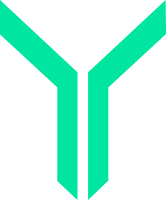
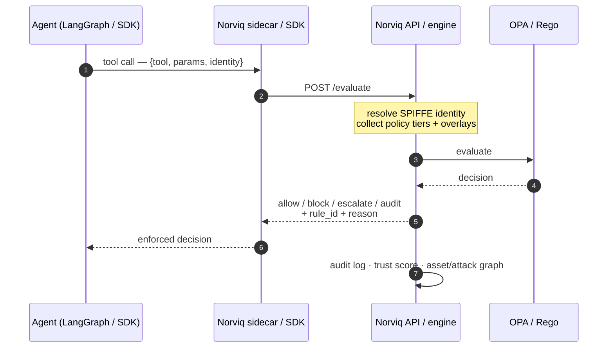
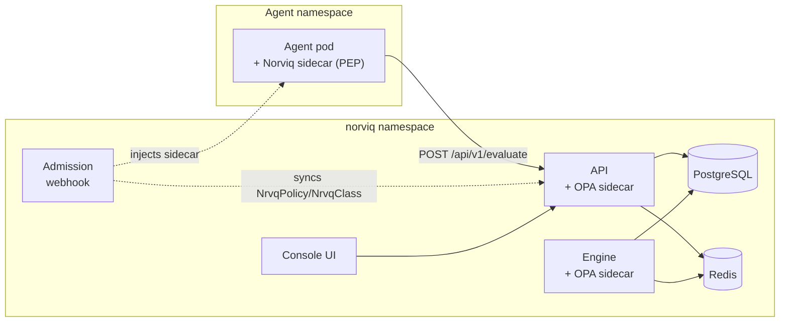

<div align="center">



# Norviq

**Runtime policy enforcement for LLM agent tool calls on Kubernetes.**

[](https://app.fossa.com/projects/git%2Bgithub.com%2Fnorviq-dev%2Fnorviq?ref=badge_shield&issueType=security)
[](https://www.bestpractices.dev/projects/16675)
[](https://artifacthub.io/packages/helm/norviq/norviq)
[](LICENSE)
[](https://kubernetes.io)
[](https://www.openpolicyagent.org)
[](https://docs.norviq.dev)

**[Documentation](https://docs.norviq.dev)** · **[Website](https://norviq.dev)** · **[Getting started](https://docs.norviq.dev/getting-started/)**

</div>

Norviq is a policy enforcement point (PEP) that sits between an AI agent's reasoning loop and the
tools it can call. Before a tool runs, the call is sent to Norviq — by the SDK inside the agent's
process, or by the agent to an injected sidecar — evaluated against OPA/Rego policies scoped to the
workload's Kubernetes/SPIFFE identity, and answered **allow, block, escalate, or audit**. The agent then
runs the tool or declines to: Norviq authorizes the call, it does not sit in the tool's network path
(see [Security model](docs/security-model.md)). It turns "the model decided to call `execute_sql` / `send_email` / `shell`" from an
implicit trust into an enforced, per-identity, auditable decision.

---

## Why

LLM agents are given real tools — databases, shells, email, cloud APIs, internal services. The model
chooses which to call at runtime, and a single prompt injection or reasoning error can turn a benign
agent into an exfiltration or destruction path. Norviq puts a deterministic, policy-driven gate on
that surface: the agent asks before each tool call, the policy for its identity decides, and in a
namespace the baseline covers, a call one of its controls refuses does not run.

## How it works

A tool call that goes through the SDK or the sidecar takes a round trip through the engine before it
executes:



- **Interception** — the SDK, or the agent through an injected sidecar, sends each tool call to the
  engine's `/evaluate` and runs the tool only if the answer allows it. This is cooperative: agent code
  that calls a tool without asking reaches it unjudged, which the opt-in `agentEgressPolicy` bounds at
  the network layer.
- **Identity** — decisions are scoped to the calling workload's namespace and agent class, so policy is
  per-agent-class and per-namespace. By default (`config.spiffeMode: mock`) the injected sidecar
  presents a per-workload HS256 token that the admission webhook mints at injection, signed with the API
  secret (`api.secretKey`); the API overwrites the namespace, agent class and SPIFFE ID in each request
  with that token's claims, so a sidecar cannot claim a sibling's identity. SPIRE-issued SVIDs
  (`config.spiffeMode: workload-api` with `config.spiffeCsi.enabled` and `webhook.spiffe.inject`) are
  opt-in. See [Concepts → Agent identity](docs/concepts.md#agent-identity).
- **Policy** — Rego policies are layered: agent-class, workload and namespace policies resolve by
  priority (the highest-priority enforcing policy wins, the most restrictive decision breaking ties; a
  policy saved in `audit` mode can only tighten). The namespace and cluster baselines, your tuned
  controls and the tighten-only overlays (sector packs, guardrails, remediation) are floors on top: they
  can make the result stricter, never looser, whatever their priority. From 0.2.6 a class policy no longer
  loosens a baseline control. Setting the control's effect in the console's Baseline controls does, for
  the whole namespace: once saved, a namespace's control effects replace the chart's baseline there, for
  every agent class, when they are this release's compile of the chart's own `strict` preset (the
  cluster baseline still applies). See
  [Concepts → Policy tiers & precedence](docs/concepts.md#policy-tiers--precedence).
- **Modes** — `block` (deny + reason), `escalate`, `audit` (log only / monitor mode), so you can trial
  a policy observably, or step the enforcing baseline back to observing (below).

### Deployed components



Both the API and the Engine evaluate **in-process** against their own OPA sidecar (one OPA per replica,
bound to `127.0.0.1`) — neither proxies to the other. In the default injection mode
(`webhook.injection.sidecarMode: proxy`) the injected sidecar POSTs every tool call to the central API,
so Postgres, Redis, and policy loading stay centralized and nothing is evaluated per-pod. The Engine
Deployment runs that same evaluator as a standalone cluster workload (`NRVQ_SIDECAR_MODE=embedded`,
exposed as `norviq-engine:8282`) for callers that want to evaluate without going through the API.
Those callers authenticate with the same service token `/api/v1/evaluate` takes, and are evaluated as
the identity bound in it.

## Works with your agent framework

The sidecar above is zero-code-change. For in-process interception instead — no sidecar, your
own event loop — the SDK (`norviq/sdk/`) wraps the tool-calling point of these frameworks so a
block/escalate decision raises before the tool ever runs. See
**[docs/guides/integrating-agents.md](docs/guides/integrating-agents.md)** for setup and snippets.

- **LangChain** — `norviq.sdk.langchain.adapter.protect(tools, interceptor)`
- **LangGraph** — `norviq.sdk.langgraph.adapter.GuardedToolNode(tools, interceptor)`
- **CrewAI** — `norviq.sdk.crewai.adapter.protect(tools, interceptor)`
- **AutoGen** — `norviq.sdk.autogen.adapter.protect(tools, interceptor)`
- **Azure / Semantic Kernel** — `norviq.sdk.semantic_kernel.adapter.policy_filter(interceptor)`

**[`examples/chatbot/`](examples/chatbot/)** is a runnable LangChain/LangGraph chatbot (Groq) where a
real model decides the tool calls and Norviq blocks the dangerous ones before they run — with a
`Dockerfile` and `k8s/` manifests for running it in-cluster behind the injected sidecar.

## Features

- **Policy enforcement** — OPA/Rego evaluated per tool call, sub-second. Under an enforcing policy, an
  evaluation error or a 4xx from the policy engine blocks the call; an unreachable engine and a namespace
  with no policy proceed by default (`webhook.injection.fallbackMode` and `noPolicyDecision` ship `allow`),
  and they can be set to `block` and `deny` respectively. See [Security model](docs/security-model.md).
- **Kubernetes-native** — `NrvqPolicy` / `NrvqClass` / `NrvqConfig` CRDs, a mutating webhook that
  injects the enforcement sidecar, and a Helm chart.
- **Workload identity** — a webhook-minted, per-workload token by default (`mock` mode); SPIFFE/SPIRE
  SVIDs as an opt-in for clusters running SPIRE.
- **Console UI** — policy catalog + editor, attack graph, asset graph, agent trust, audit stream.
- **Red-team suite** — built-in adversarial tests (prompt injection, encoding/nesting evasion, SQLi,
  PII/PCI exfil) that prove a policy actually blocks.
- **Compliance mapping** — MITRE ATLAS and OWASP LLM Top-10 coverage with generate-enforcing-policy
  remediation.
- **High availability** — multi-replica with cross-replica policy propagation and DB-authoritative
  deletes; HPA/PDB/anti-affinity for multi-node clusters.
- **Multi-cluster (fleet)** — signed policy-bundle distribution across a hub and spoke clusters.

## Scope

Norviq decides whether an agent's tool call may run, before it runs. In scope:

- Per-call allow / block / escalate / audit decisions on a tool call's inputs (`tool_name` and
  `tool_params`), against OPA/Rego policy scoped to the calling workload's identity.
- The pieces that deliver that on Kubernetes: the API and engine, the admission webhook and injected
  sidecar, the `NrvqPolicy` / `NrvqClass` / `NrvqConfig` CRDs, the Helm chart and the console.
- The SDK adapters for agent frameworks, and the MCP proxy that gates MCP servers at discovery and at
  call time.

Out of scope, by design (see [Security model → What Norviq defends](docs/security-model.md#what-norviq-defends)
for the first item and [Known design decisions / non-goals](docs/security-model.md#known-design-decisions--non-goals)
for the rest):

- **Network interposition.** Norviq authorizes a call; it does not sit in the tool's network path. Agent
  code that calls a tool without asking reaches it unjudged; the opt-in `agentEgressPolicy` bounds that
  at the network layer.
- **Tool outputs.** A call's return payload is not inspected unless the opt-in output-DLP hook is on.
- **Data with no recognisable shape.** The content detectors match known shapes (card numbers, SSNs,
  credential prefixes). For anything else, the control is a destination allowlist in policy.
- **Admission-time validation of policy objects.** The controller validates `NrvqPolicy` objects when
  it syncs them and skips invalid ones; there is no ValidatingAdmissionPolicy in the chart.

## Try it without a cluster

The MCP action-firewall runs as a plain stdio proxy, so you can put it in front of an MCP server on a
laptop and see what it does before deciding whether the Kubernetes install is worth it.

**Prerequisites:** Python 3.11+.

```bash
pip install norviq

# Wrap any MCP server. Norviq spawns it as a child process and sits on the stdio pair.
python -m norviq.mcp --server-id filesystem -- \
  npx -y @modelcontextprotocol/server-filesystem /work
```

Point your MCP host (Claude Desktop, Cursor, any stdio client) at that command instead of the
server's own, and every `tools/list` and `tools/call` goes through the gates on the way past.

To front a remote server instead of spawning one:

```bash
python -m norviq.mcp --http --listen 127.0.0.1:9000 --upstream https://mcp.example.com/mcp
```

**What local mode does and does not do.** Gate A still scans tool definitions for injection patterns
and content-hash pins six fields per tool (`name`, `title`, `description`, `inputSchema`,
`outputSchema`, `annotations`), so a definition that changes between runs is visible. What it cannot
do without a control plane is ask whether a server should be spoken to at all — every local discovery
logs `gate_a.server_decision_unavailable` — and Gate B has no policy to evaluate, so calls are
allowed. **Local mode is a scanner and a change detector, not an enforcement point.** The Kubernetes
install below is what gives Gate B something to decide with.

## Quick start (Kubernetes)

**Prerequisites:** a Kubernetes cluster (1.30+), `kubectl`, and Helm 3.

```bash
kubectl create namespace norviq

# Create the tenant namespaces FIRST. Each one listed in policyQuotaNamespaces gets a ResourceQuota
# and a baseline policy, and both are namespaced — so the install fails on a namespace that does not
# exist yet. (The chart now says so by name if you forget, rather than failing partway through.)
kubectl create namespace default 2>/dev/null || true

# Installs from the published, cosign-signed chart. CRDs ship inside it, and every Norviq image is
# pinned by immutable digest — so this deploys exactly the bytes that release published.
helm install norviq oci://ghcr.io/norviq-dev/charts/norviq --version 0.2.8 -n norviq \
  --set 'policyQuotaNamespaces={default}' \
  --set config.dbSslMode=disable   # the bundled Postgres has no TLS; omit if you point at an external TLS DB
```

Working on Norviq itself, or a modified chart? Install from a clone instead — apply
`helm/norviq/crds/` first, then `helm install norviq ./helm/norviq`. See
[getting-started](https://docs.norviq.dev/getting-started/) for that path.

`policyQuotaNamespaces` is the list of tenant namespaces that will run agents — it is **required**, not
optional. The chart installs a `strict`-preset namespace baseline for each entry, so an empty list
fails the install by design rather than shipping a cluster with no baseline. From 0.2.6 that baseline
**enforces** (`baselineClusterPolicy.enforcementMode: block`): 20 of its 21 controls act on the call —
17 refuse it, `llm06_excessive_agency` refuses destructive tools and holds elevated ones for approval,
and two MCP controls hold it for approval — and `scope_violation_dangerous_tool` records without
blocking. Through 0.2.5 it shipped in `audit`. It is not fail-closed as a whole: a namespace outside
this list has no baseline, and an API outage still follows `webhook.injection.fallbackMode`, which ships
`allow`.

To turn it off, pick the scope. Each records the call instead of refusing it, except a control
switched Off, which is not evaluated at all:

- **Every namespace, at install:** `--set baselineClusterPolicy.enforcementMode=audit` (the 0.2.5
  posture, in every namespace whose Baseline controls nobody has saved).
- **One namespace:** console → Target Settings → **Monitor**, or `PUT /api/v1/settings?namespace=<ns>`
  with `{"enforcement_mode": "audit"}`. This softens every block in that namespace, not only the
  baseline's, except a trust freeze, an invalid agent identity (`invalid_spiffe_identity`) and the rate
  limit.
- **One control:** console → Baseline controls → **Monitor** or **Off** (`PUT /api/v1/baseline/controls`).

[Concepts → Turning the shipped baseline off](docs/concepts.md#turning-the-shipped-baseline-off) has the
details, including what saving the controls panel does under an `audit` install.

Add every agent namespace you plan to use, and **create them before installing** — the baseline policy
and quota are namespaced objects, so the install cannot place them in a namespace that does not exist
yet. If one is missing the chart stops before applying anything and names it.

The chart deploys the API, engine, console UI, mutating webhook, and bundled PostgreSQL + Redis + OPA.
Port-forward the console:

```bash
kubectl -n norviq port-forward svc/norviq-ui 8080:80
# open http://localhost:8080
```

Sign in as `admin`. The chart generates a random first password on install (it only uses a literal
password if you set `auth.adminPassword` yourself) — read it back, then change it when the console
prompts you:

```bash
kubectl get secret norviq-secrets -n norviq -o jsonpath='{.data.NRVQ_AUTH_ADMIN_PASSWORD}' | base64 -d
```
> **This is the FIRST password only.** The Secret is written at install and never updated
> again, so once you complete the forced change it is stale — the live password lives hashed
> in Postgres. If it is rejected, you already changed it; the Secret is not a recovery path.


Sidecar injection ships **off** (`webhook.injection.enabled: false`). Turn it on, then label the same
namespaces you listed in `policyQuotaNamespaces` — the label alone does nothing until the webhook is
enabled:

```bash
helm upgrade norviq oci://ghcr.io/norviq-dev/charts/norviq --version 0.2.8 -n norviq --reset-then-reuse-values --set webhook.injection.enabled=true
kubectl label namespace <your-agent-namespace> norviq-injection=enabled
```

`--reset-then-reuse-values` (Helm ≥ 3.14), not `--reuse-values`: the latter replays only the values
*you* supplied last time and does not merge in values a newer chart added, so an upgrade across a
release that introduced one fails with `nil pointer evaluating interface {}`. On older Helm, pass
your own `-f values.yaml`.

Then label each agent **pod** `norviq.io/agent-class=<class>` — that pod label is what gets the
enforcement sidecar injected, not the namespace label alone. The namespace label opts the namespace
in; the pod label says which pods are agents. A pod without it starts un-injected and ungoverned.

That is deliberate (`webhook.injection.gateOnlyAgentPods`, default `true`): with `failurePolicy: Fail`,
routing every pod in the namespace through the webhook would make Norviq's availability a precondition
for starting that namespace's database and ingress too. Set it to `false` for namespace-wide injection.

> Trying it locally? A single-node [kind](https://kind.sigs.k8s.io/) cluster is enough to evaluate
> everything except multi-node HA. See **[docs/getting-started.md](docs/getting-started.md)**.

## Documentation

Full documentation is at **[docs.norviq.dev](https://docs.norviq.dev)**:

- **[Getting started](https://docs.norviq.dev/getting-started/)** — install, first login, sidecar injection, first policy
- **[Concepts](https://docs.norviq.dev/concepts/)** — agent classes, policy tiers, enforcement modes, trust score, SPIFFE identity
- **[Writing policies](https://docs.norviq.dev/guides/writing-policies/)** — the Rego contract, packages, tighten-only overlays, validation
- **[Policy cookbook](https://docs.norviq.dev/guides/policy-cookbook/)** — copy-paste `NrvqPolicy` recipes + validated Rego building blocks
- **[Asset & attack graphs](https://docs.norviq.dev/guides/graphs/)** — real reach, kill chains, Simulate, Defend, tool classification
- **[Compliance & coverage](https://docs.norviq.dev/guides/compliance/)** — MITRE ATLAS / OWASP LLM coverage, gaps, remediation, evidence pack
- **[MCP firewall](https://docs.norviq.dev/guides/mcp-servers/)** — governing MCP servers: the discovery and invocation gates, definition pinning and drift, and writing policy against `input.mcp`
- **[Integrating agents](https://docs.norviq.dev/guides/integrating-agents/)** — the SDK: LangChain, LangGraph, CrewAI, AutoGen, Semantic Kernel
- **[CLI reference](https://docs.norviq.dev/cli/)** — `norviq login`, policies, audit, agents, red-team, fleet
- **[Configuration](https://docs.norviq.dev/configuration/)** — Helm `values.yaml` reference
- **[Deployment](https://docs.norviq.dev/deployment/)** — production HA, cloud (AKS / EKS / GKE), and multi-cluster fleet
- **[Security model](https://docs.norviq.dev/security-model/)** — trust boundaries and the threat model

Runnable examples live under [`examples/`](examples/); engineering references under
[`docs/engineering/`](docs/engineering/).

## Development

```bash
pip install -e ".[dev]"   # backend + test tooling
make test                 # pytest tests/
make lint                 # ruff check norviq/ tests/
```

The console suite runs from `ui/` with `npm test` (vitest). The shipped Rego is v0-syntax, so its suite
needs the compatibility flag:

```bash
opa test --v0-compatible webhook/presets/ comprehensive.rego
```

The stack is Python (FastAPI) + OPA/Rego for the engine, React + Vite (TypeScript) for the console, and
Go for the admission webhook. See **[CONTRIBUTING.md](CONTRIBUTING.md)**.

## Community

Norviq's channels are GitHub issues and Discussions, listed below. There is no mailing list, chat
channel or regular community meeting yet. Report a security issue privately as
[SECURITY.md](SECURITY.md) describes, never in a public issue.

- **Issues** — bugs and reproducible findings. [`good first issue`](https://github.com/norviq-dev/norviq/issues?q=is%3Aissue+is%3Aopen+label%3A%22good+first+issue%22)
  items each carry a file path, a reproduction and a definition of done.
- **[Discussions](https://github.com/norviq-dev/norviq/discussions)** — show us your policy, say which
  framework you run, argue about what comes after MCP.
- [CONTRIBUTING.md](CONTRIBUTING.md) · [CODE_OF_CONDUCT.md](CODE_OF_CONDUCT.md) · [GOVERNANCE.md](GOVERNANCE.md) · [MAINTAINERS.md](MAINTAINERS.md) · [REVIEWING.md](REVIEWING.md) · [RELEASES.md](RELEASES.md) · [ROADMAP.md](ROADMAP.md) · [SECURITY.md](SECURITY.md) · [CHANGELOG.md](CHANGELOG.md)
- **Running it somewhere real?** Add yourself to [ADOPTERS.md](ADOPTERS.md).

### Code of Conduct

Everyone taking part in Norviq follows the
[CNCF Code of Conduct](https://github.com/cncf/foundation/blob/main/code-of-conduct.md), adopted by
reference in [CODE_OF_CONDUCT.md](CODE_OF_CONDUCT.md) (the CNCF project-template form). Report a
violation to `conduct@norviq.dev`, which reaches the maintainer. Norviq is not a CNCF project; the
CNCF Code of Conduct Committee route applies only if and when it is accepted.

## Security

Found a vulnerability? Please follow the coordinated-disclosure process in **[SECURITY.md](SECURITY.md)** —
do not open a public issue for security reports.

## SBOM

Each container image a release publishes (engine, api, ui, webhook and bootstrap, as
`ghcr.io/norviq-dev/norviq-engine:<component>-<version>`) has a software bill of materials:

- **Format:** SPDX JSON, generated by Trivy from the built image (`.github/workflows/build.yml`).
- **Where:** attached to the image digest in the registry as a cosign attestation of type `spdxjson`,
  signed keylessly by the workflow that built the image. The image SBOMs are not GitHub release assets.
- **Release source SBOM:** each tagged release also attaches an SPDX JSON SBOM of the tagged source
  (generated by Trivy from the lockfiles) to its GitHub Release, next to the wheel, sdist and chart,
  each with a keyless Sigstore bundle (`<file>.sigstore.json`).
- **Not covered:** the Helm chart and the PyPI package have no SBOM of their own beyond that source
  SBOM.

To verify an image's SBOM attestation and print the SBOM:

```bash
cosign verify-attestation --type spdxjson \
  --certificate-identity-regexp '^https://github.com/norviq-dev/norviq/.github/workflows/build.yml@.*' \
  --certificate-oidc-issuer https://token.actions.githubusercontent.com \
  ghcr.io/norviq-dev/norviq-engine:api-<version> | jq -r '.payload' | base64 -d | jq '.predicate'
```

Third-party NOTICE files that the Apache License requires us to reproduce are in [NOTICE](NOTICE).

## License

[Apache 2.0](LICENSE).
